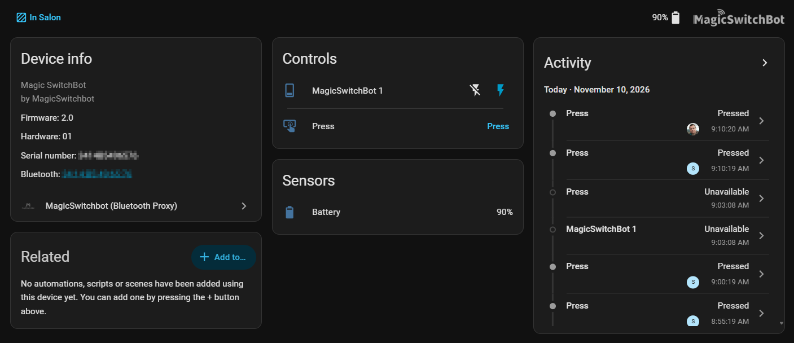

# MagicSwitchbot (Bluetooth Proxy)

A Home Assistant integration for **Magic Switchbot**, controlled over BLE
using a local Bluetooth adapter or an ESPHome Bluetooth proxy. It provides
`switch` and `button` entities, a battery sensor, and an optional RSSI sensor.

## Requirements

- Home Assistant 2026.3 or later
- **Connectable** Bluetooth, provided by a local BLE adapter or an ESPHome Bluetooth proxy
- A MagicSwitchbot device within Bluetooth range

## Limitations

- **Password-protected devices are not supported.** The integration does not yet
  ask for or send the device password, so commands fail while a password is set.
  Remove the password in the official MagicSwitchBot app, then add the device to Home Assistant.

## Installation

### Home Assistant 2026.11 or later: Marketplace (recommended)

1. Go to **Settings → Marketplace**.
2. The first time you open the Marketplace, read the notice and select **I understand the risks and agree**. Browsing works without this, but installing does not.
3. Search for **MagicSwitchbot (Bluetooth Proxy)** and select **Install**.
4. The setup flow opens automatically. If it does not, go to **Settings → Devices & services → Add integration** and select **MagicSwitchbot (Bluetooth Proxy)**.

No restart is needed for a new installation. Updates may ask you to restart Home Assistant.

### Home Assistant 2026.10 or earlier: HACS

1. In HACS, open **Integrations**.
2. Search for **MagicSwitchbot (Bluetooth Proxy)** and select **Download**.
3. **Restart Home Assistant.**
4. Go to **Settings → Devices & services → Add integration** and select **MagicSwitchbot**.

### Fallback: custom repository

Use this only if the integration does not appear in the catalog yet.

- **2026.11 or later:** go to **Settings → Marketplace**, select **Add from link**, and enter `https://github.com/mnowok/magicswitchbot_ble`. Approve the GitHub device sign-in, then install **MagicSwitchbot (Bluetooth Proxy)**.
- **2026.10 or earlier:** in HACS, open **⋮ → Custom repositories**, enter `https://github.com/mnowok/magicswitchbot_ble`, select **Integration** as the category, then download it and restart Home Assistant.

## Configuration

The integration discovers devices automatically by their `MagicSwitchBot*`
advertised name and manufacturer ID `1282`.

If your device does not appear—for example, because it is asleep and not
advertising—choose the manual MAC address option in the setup flow. Enter the
address in this format: `AA:BB:CC:DD:EE:FF`.

## Options

| Option | Default | Description |
|---|---:|---|
| `enable_switch` | `true` | Create a switch entity |
| `enable_button` | `true` | Create a button entity |
| `enable_battery` | `true` | Create a battery sensor |
| `enable_rssi` | `false` | Create an RSSI sensor |
| `retry_count` | `3` | Number of command retries |
| `command_timeout` | `30` | Command timeout in seconds |

## Troubleshooting

- **The device does not appear in the list:** Try manual setup. A sleeping device may not be advertising over BLE.
- **The battery level does not update:** The value comes from BLE advertisements, so it updates when the device advertises again.
- **Commands do not reach the device:** Check that the Bluetooth proxy is connectable and within range.
- **Commands fail and the device was working in the official app:** The device may have a password set. The integration does not support passwords yet. Remove the password in the official app and try again.

To enable debug logging:

    logger:
      default: warning
      logs:
        custom_components.magicswitchbot_ble: debug

## License

MIT. This project is not affiliated with Shenzhen Interear or SwitchBot.