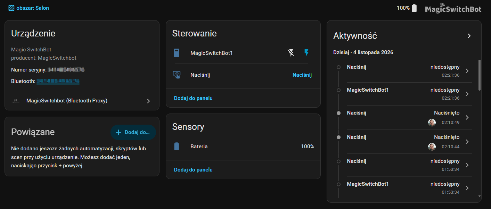

# MagicSwitchbot (Bluetooth Proxy)

A Home Assistant integration for **Magic Switchbot**, controlled over BLE
using a local Bluetooth adapter or an ESPHome Bluetooth proxy. It provides
`switch` and `button` entities, a battery sensor, and an optional RSSI sensor.

## Requirements

- Home Assistant 2026.8 or later
- **Connectable** Bluetooth, provided by a local BLE adapter or an ESPHome Bluetooth proxy
- A MagicSwitchbot device within Bluetooth range

## Installation

### Home Assistant 2026.11 or later: Marketplace (recommended)

1. Go to **Settings → Marketplace**.
2. The first time you open the Marketplace, read the notice and select **I understand the risks and agree**. Browsing works without this, but installing does not.
3. Search for **MagicSwitchbot (Bluetooth Proxy)** and select **Install**.
4. The setup flow opens automatically. If it does not, go to **Settings → Devices & services → Add integration** and select **MagicSwitchbot (Bluetooth Proxy)**.

No restart is needed for a new installation. Updates may ask you to restart Home Assistant.

### Home Assistant 2026.10 or earlier: HACS

1. In HACS, open **Integrations**.
2. Search for **MagicSwitchbot (Bluetooth Proxy)** and select **Download**.
3. **Restart Home Assistant.**
4. Go to **Settings → Devices & services → Add integration** and select **MagicSwitchbot**.

### Fallback: custom repository

Use this only if the integration does not appear in the catalog yet.

- **2026.11 or later:** go to **Settings → Marketplace**, select **Add from link**, and enter `https://github.com/mnowok/magicswitchbot_ble`. Approve the GitHub device sign-in, then install **MagicSwitchbot (Bluetooth Proxy)**.
- **2026.10 or earlier:** in HACS, open **⋮ → Custom repositories**, enter `https://github.com/mnowok/magicswitchbot_ble`, select **Integration** as the category, then download it and restart Home Assistant.

## Configuration

The integration discovers devices automatically by their `MagicSwitchBot*`
advertised name and manufacturer ID `1282`.

If your device does not appear—for example, because it is asleep and not
advertising—choose the manual MAC address option in the setup flow. Enter the
address in this format: `AA:BB:CC:DD:EE:FF`.

### PIN

The device can be protected with a 6-digit PIN. The official MagicSwitchBot app
calls it a password.

If the device has a PIN, enter it in the **PIN** field during setup. Leave the
field empty if the device has no PIN.

To manage the PIN later, go to **Settings → Devices & services → MagicSwitchbot
(Bluetooth Proxy)** and select **⋮ → Reconfigure** next to the device entry:

| Option | On the device | In Home Assistant |
|---|---|---|
| **Enter the PIN changed in the app** | Nothing changes | Saves the PIN you already set in the app |
| **Set or change the PIN on the device** | Sets the new PIN | Saves the new PIN |
| **Remove the PIN from the device** | Removes the PIN | Saves "no PIN" |

Home Assistant checks the PIN on the device before it saves it. After you change
or remove the PIN from Home Assistant, use the new PIN, or no PIN, in the app as
well.

If the device rejects the PIN, for example because you changed or removed it in
the app, Home Assistant asks you to reauthenticate. Enter the current PIN, or
leave the field empty if you removed it.

In all cases, close the MagicSwitchBot app first. The device must be in range
and not connected to your phone.

### Availability

Entities become unavailable when no connectable Bluetooth adapter or ESPHome
proxy has seen the device recently, for example when it is out of range or its
battery is empty. They become available again with the next BLE advertisement.
The switch keeps its last known ON/OFF state.

## Options

| Option | Default | Description |
|---|---:|---|
| `enable_switch` | `true` | Create a switch entity |
| `enable_button` | `true` | Create a button entity |
| `enable_battery` | `true` | Create a battery sensor |
| `enable_rssi` | `false` | Create an RSSI sensor |
| `retry_count` | `3` | Number of command retries, each over a new BLE connection. A push is not retried once the command was sent, so the device is never pressed twice |
| `command_timeout` | `60` | Total time limit for a command in seconds (30–120), including all retries. A single connection attempt can take up to 20 seconds |

## Troubleshooting

- **The device does not appear in the list:** Try manual setup. A sleeping device may not be advertising over BLE.
- **The battery level does not update:** The value comes from BLE advertisements, so it updates when the device advertises again.
- **Commands do not reach the device:** Check that the Bluetooth proxy is connectable and within range.
- **Commands fail with a connection error while the official app is open:** The device accepts only one Bluetooth connection at a time. While the MagicSwitchBot app on your phone is connected to it, Home Assistant cannot connect. Close the app completely (force stop it), or turn off Bluetooth on the phone, and try again.
- **Commands fail and the device was working in the official app:** The device may have a PIN set. Enter it when Home Assistant asks you to reauthenticate.
- **Entities are unavailable:** Home Assistant has not received a BLE advertisement from the device recently. Check the battery and the distance to the Bluetooth proxy.

When reporting a problem, attach the diagnostics file: go to **Settings → Devices &
services → MagicSwitchbot (Bluetooth Proxy)**, then select **⋮ → Download diagnostics**
next to the device entry. The PIN is removed from the file.

To enable debug logging:

    logger:
      default: warning
      logs:
        custom_components.magicswitchbot_ble: debug

## License

MIT. This project is not affiliated with Shenzhen Interear or SwitchBot.